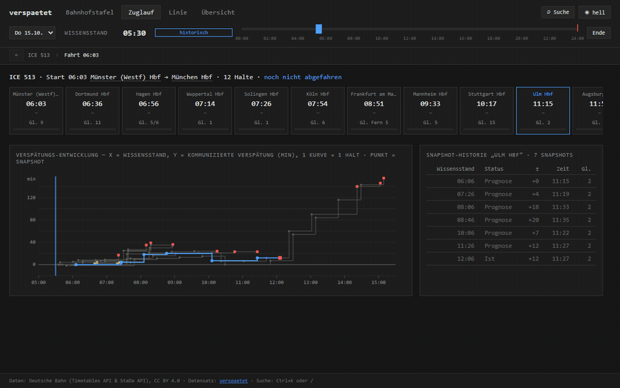
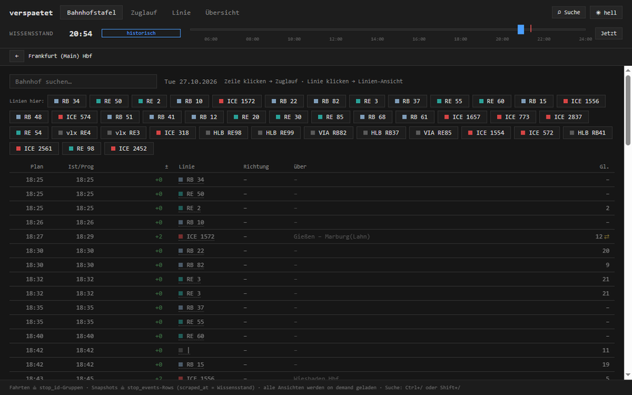

# verspaetet-explorer

Explore the [verspaetet](https://github.com/LinusRichter/verspaetet) dataset: Deutsche Bahn delay snapshots for all ~5,400 German IRIS stations, published monthly on [HuggingFace](https://huggingface.co/datasets/LinusRichter404/verspaetet).

Scrub through time and watch how the communicated delay of a train evolved, look at a station board as it was at any moment, follow a train along its route, or compare lines and days.

## The data in one paragraph

Each month has `stop_events.parquet` (one row per *change* of a train's forecast at one station: planned/actual time, platform, route, cancellation), `scrape_runs.parquet` (the fetch log: one row per successful board fetch, so "unchanged" can be told apart from "not observed"), `manifest.json` (checksums, coverage, known downtimes) and a README. `stations.parquet` at the repo root is the station registry. Details: [dataset card](https://huggingface.co/datasets/LinusRichter404/verspaetet).

## License

Data: Deutsche Bahn (Timetables API & StaDa API), license [CC BY 4.0](https://creativecommons.org/licenses/by/4.0/). Dataset: verspaetet, [huggingface.co/datasets/LinusRichter404/verspaetet](https://huggingface.co/datasets/LinusRichter404/verspaetet). Keep this attribution when you show or reuse the data.
